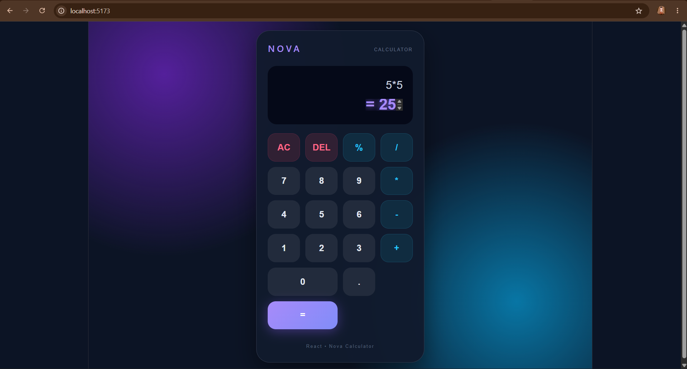

# Ex04 Simple Calculator - React Project
## Date:21-11-2026
## Name : Mohammed Zubair R
## Reg No : 212225040252

## AIM
To  develop a Simple Calculator using React.js with clean and responsive design, ensuring a smooth user experience across different screen sizes.

## ALGORITHM
### STEP 1
Create a React App.

### STEP 2
Open a terminal and run:
  <ul><li>npx create-react-app simple-calculator</li>
  <li>cd simple-calculator</li>
  <li>npm start</li></ul>

### STEP 3
Inside the src/ folder, create a new file Calculator.js and define the basic structure.

### STEP 4
Plan the UI: Display screen, number buttons (0-9), operators (+, -, *, /), clear (C), and equal (=).

### STEP 5
Create a new file Calculator.css in src/ and add the styling.

### STEP 6
Open src/App.js and modify it.

### STEP 7
Start the development server.
  npm start

### STEP 8
Open http://localhost:3000/ in the browser.

### STEP 9
Test the calculator by entering numbers and operations.

### STEP 10
Fix styling issues and refine content placement.

### STEP 11
Deploy the website.

### STEP 12
Upload to GitHub Pages for free hosting.

## PROGRAM
### App.jsx
```jsx

import { useState } from "react";
import "./App.css";

function App() {
  const [display, setDisplay] = useState("");
  const [result, setResult] = useState("");

  const handleClick = (value) => {
    if (value === "AC") {
      setDisplay("");
      setResult("");
    } 
    else if (value === "DEL") {
      setDisplay(display.slice(0, -1));
    } 
    else if (value === "=") {
      calculate();
    } 
    else {
      setDisplay(display + value);
    }
  };

  const calculate = () => {
    try {
      let expression = display.replace(
        /(\d+\.?\d*)%/g,
        "($1/100)"
      );

      if (!/^[0-9+\-*/().\s]+$/.test(expression)) {
        setResult("Error");
        return;
      }

      const answer = Function(
        '"use strict"; return (' + expression + ')'
      )();

      if (!Number.isFinite(answer)) {
        setResult("Error");
      } else {
        setResult(Number(answer.toFixed(8)).toString());
      }
    } catch {
      setResult("Error");
    }
  };

  const buttons = [
    "AC", "DEL", "%", "/",
    "7", "8", "9", "*",
    "4", "5", "6", "-",
    "1", "2", "3", "+",
    "0", ".", "="
  ];

  return (
    <div className="main-container">
      <div className="calculator">

        <div className="header">
          <h2>NOVA</h2>
          <span>CALCULATOR</span>
        </div>

        <div className="display">
          <div className="expression">
            {display || "0"}
          </div>

          <div className="result">
            {result !== "" ? "= " + result : ""}
          </div>
        </div>

        <div className="buttons">
          {buttons.map((btn) => (
            <button
              key={btn}
              className={
                btn === "="
                  ? "equal"
                  : ["AC", "DEL"].includes(btn)
                  ? "special"
                  : ["%", "/", "*", "-", "+"].includes(btn)
                  ? "operator"
                  : btn === "0"
                  ? "zero"
                  : ""
              }
              onClick={() => handleClick(btn)}
            >
              {btn}
            </button>
          ))}
        </div>

        <p className="footer">
          React • Nova Calculator
        </p>

      </div>
    </div>
  );
}

export default App;
```
### App.css
```css

* {
  margin: 0;
  padding: 0;
  box-sizing: border-box;
}

body {
  font-family: Arial, sans-serif;
  background: #0c1425;
}

.main-container {
  min-height: 100vh;
  display: flex;
  justify-content: center;
  align-items: center;
  padding: 20px;
  background:
    radial-gradient(circle at 15% 15%, #54209b, transparent 35%),
    radial-gradient(circle at 85% 80%, #0876a5, transparent 35%),
    #0c1425;
}

.calculator {
  width: 375px;
  padding: 27px 25px 22px;
  background: rgba(17, 26, 45, 0.96);
  border: 1px solid #30394c;
  border-radius: 30px;
  box-shadow: 0 20px 50px rgba(0, 0, 0, 0.4);
}

.header {
  display: flex;
  justify-content: space-between;
  align-items: center;
  margin-bottom: 20px;
}

.header h2 {
  color: #a78bfa;
  letter-spacing: 5px;
  font-size: 20px;
}

.header span {
  color: #65738b;
  font-size: 10px;
  letter-spacing: 2px;
}

.display {
  height: 130px;
  background: #050918;
  border-radius: 20px;
  padding: 22px;
  margin-bottom: 20px;
  display: flex;
  flex-direction: column;
  justify-content: center;
  align-items: flex-end;
  overflow: hidden;
}

.expression {
  color: #cbd5e1;
  font-size: 25px;
  min-height: 35px;
  max-width: 100%;
  overflow-x: auto;
}

.result {
  color: #a78bfa;
  font-size: 34px;
  font-weight: bold;
  margin-top: 8px;
  text-shadow: 0 0 15px #9874ff;
  max-width: 100%;
  overflow-x: auto;
}

.buttons {
  display: grid;
  grid-template-columns: repeat(4, 1fr);
  gap: 12px;
}

button {
  height: 63px;
  border: none;
  border-radius: 18px;
  background: #222b3c;
  color: #e2e8f0;
  font-size: 20px;
  font-weight: bold;
  cursor: pointer;
  transition: 0.2s;
}

button:hover {
  background: #344158;
  transform: translateY(-2px);
}

button:active {
  transform: scale(0.95);
}

.special {
  background: #302033;
  color: #ff6686;
  border: 1px solid #54253e;
}

.operator {
  background: #102c40;
  color: #25c6ff;
  border: 1px solid #174761;
}

.zero {
  grid-column: span 2;
}

.equal {
  grid-column: span 2;
  background: linear-gradient(135deg, #a78bfa, #818cf8);
  color: white;
  box-shadow: 0 5px 25px rgba(139, 92, 246, 0.4);
}

.equal:hover {
  background: linear-gradient(135deg, #b69cff, #929bff);
}

.footer {
  color: #526078;
  text-align: center;
  font-size: 10px;
  letter-spacing: 2px;
  margin-top: 25px;
}

@media (max-width: 420px) {
  .calculator {
    width: 100%;
    max-width: 375px;
    padding: 22px 18px;
  }

  button {
    height: 58px;
  }
}
```
### main.jsx
```jsx 
import { StrictMode } from 'react'
import { createRoot } from 'react-dom/client'
import './index.css'
import App from './App.jsx'
import './App.css'

createRoot(document.getElementById('root')).render(
  <StrictMode>
    <App />
  </StrictMode>,
)
```
## OUTPUT


## RESULT
The program for developing a simple calculator in React.js is executed successfully.